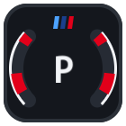

# VClusters

Single BMW M3/M4 G80/G82-inspired instrument-cluster design: twin bowed 0–8 rev blades around the gear and road speed, M setup rows, fuel and temperature side gauges, plus range, time and outside temperature. Vehicle values continue to use the app's existing live signal bindings.
